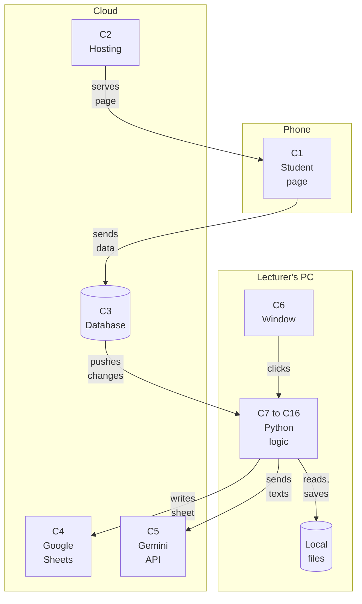
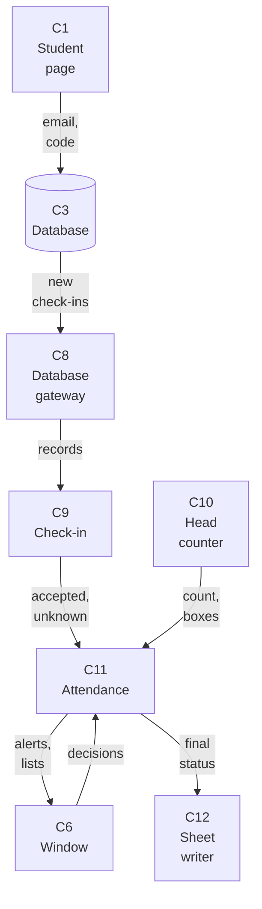
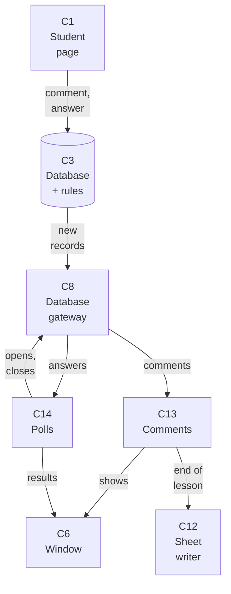
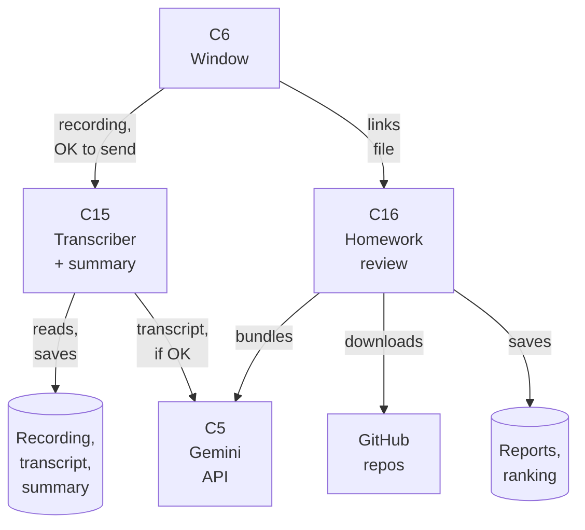

# Main Software Components

Ex2 in Introduction to Software Engineering (OOP, OOD), Ariel University.
Project: Web-based Teaching Tool.

This document lists the main parts of the system:
- what each part does,
- where it runs,
- which other parts it talks to,
- which requirements it implements.

The requirements are in the SRS ([srs.md](srs.md)), and the class and sequence diagrams are in the design ([design.md](design.md)). Each component also names the test code in `tools-tests/` that already proved its tool. That code is the base for the demo: we compose tested tools ("find and compose") and write only the glue and the classes ("vibe coding").

## 1. How to read the diagrams

The diagrams in this document are **component diagrams**. They show which parts exist, where they run, and what passes between them. They are not UML class diagrams: those are in [design.md](design.md), with their own legend.

| Sign | Meaning |
|---|---|
| A rectangle | A component: a part of our system, or an outside service. `C1` to `C16` are the component IDs used in this document. |
| A cylinder | Stored data: the database, or files on a computer. |
| A large frame with a title | The place where the components inside it run: the phone, the cloud, or the lecturer's computer. |
| A solid arrow with a label | One component sends data to another, or calls it. The label says what passes. The arrow points in the direction the data goes. |
| A double arrow | Data goes both ways. |

Each diagram has at most eight components. Under each one there is a short explanation in plain words, and an example with numbers.

## 2. Overview: where everything runs

**In plain words:** the phone gets the page from the cloud, and sends everything the student types to the database. It never talks to the lecturer's computer directly. The database pushes each new record to the Python logic on the lecturer's computer, in real time. The lecturer clicks buttons in the window, and the Python logic does the work: it reads the photos and the recordings from local files, writes the sheet, and sends texts to Gemini: the homework bundles, and the lesson transcript after the lecturer confirms.

**Example with numbers:** 50 students check in during a lesson. That is 50 records that go from 50 phones to the database. The database pushes the 50 records to Python, one by one, about 3 to 4 seconds after each was sent (tools report, section 1). The class photo goes nowhere: Python reads it from a local file, and only the number, for example 30, is used later.

## 3. How the components work together

### 3.1 Attendance

**In plain words:** the student checks in from the phone, and the check-in goes to the database. The gateway (C8) is the only Python part that reads the database, and it passes the check-ins to C9. C9 throws out check-ins with an old code, and marks emails that are not on the course list. Separately, the head counter (C10) counts the people in the photos. The attendance component (C11) puts the two numbers side by side. If they differ, it sends a mismatch alert to the window. The lecturer decides, and C11 gives the final status of each student to the sheet writer (C12).

**Example with numbers:**
1. **Check-in:** 53 check-ins arrive. C9 rejects 2, because their code is older than 20 seconds. It counts one student who checked in twice only once. That leaves 50 accepted check-ins. One of them has an email that is not on the course list.
2. **Head count:** the lecturer adds 3 photos. C10 counts 28, 30 and 29 people. The lesson's head count is the highest: **30**.
3. **Mismatch:** C11 compares 50 check-ins with 30 people. They differ by 20, so the window shows an alert: "50 checked in, 30 counted". A second alert line shows the unknown email.
4. **Challenge:** the lecturer starts a challenge. The photo with 30 boxes appears on the projector. Of the 50 students who checked in:
   - 27 choose a box of their own,
   - 3 more choose boxes that were already taken, so 3 boxes are chosen twice,
   - 20 do not answer.
5. **The lecturer decides:** the 20 who did not answer are most likely not in the room. For the 3 boxes chosen twice, the lecturer looks at the room and decides.
6. **The sheet:** C11 gives C12 the final status, and C12 writes one row per student with "present" or "absent" for this lesson.

### 3.2 Comments and polls

**In plain words:** comments and poll answers travel the same way: from the phone to the database, and from there through the gateway to Python. The security rules in the database are the guard. They reject a comment when comments are closed, and an answer when the poll is closed. Comments (C13) are shown to the lecturer as they arrive, and are written to the sheet at the end of the lesson. Polls (C14) also write to the database: they open and close the poll there.

**Example with numbers:**
- **A poll:** the lecturer opens a poll with 3 options and the default duration of 2 minutes. During the 2 minutes, 41 phones answer: 25 choose A, 10 choose B, and 6 choose C. One student taps twice, but the phone remembers that it already answered, and blocks the second tap. After 2 minutes, C14 closes the poll. A late answer, at 2:05, is rejected by the security rules. The window shows 25 / 10 / 6.
- **Comments:** the comments are set to "only after the lesson". During the lesson, the page tells the students that comments are closed. After the lesson, 7 comments arrive. At the lecturer's request, C13 gives them to C12, which writes 7 rows to the "Comments" tab, with no names.

### 3.3 Lecture summary and homework review

**In plain words:** these two features run after the lesson, and both start from the window. Both use Gemini through the same engine interface (`ReviewEngine`), with the same manual backup.
- **Summary (C15):** C15 turns the recording into text on the lecturer's computer. Before the transcript is sent, the window asks the lecturer to confirm, because the transcript may hold names and voices of students, and on the free tier Google uses the content. Only after "OK" does C15 send the transcript to Gemini and save the summary. If the lecturer does not confirm, the transcript stays on the computer.
- **Review (C16):** C16 downloads each repository from GitHub, packs it, sends it to Gemini, and saves the reports. It never sends a name or a link, only "Repo A", "Repo B", and so on.

**Example with numbers:**
- **Summary:** a 90-minute recording. The measured speed was 66.5 seconds of work per minute of recording, so the transcript takes about 100 minutes. The window then asks: "Send the transcript to Gemini?" The lecturer clicks "OK", and the summary comes back in one request. The summary has its own Google project and key, with its own 20 requests per day, so a long review never blocks it. One summary per day is enough. The summary is ready about two hours after the lesson. If the lecturer clicks "No", nothing is sent, and the lecturer has the transcript only.
- **Review:** a links file with 45 repositories. One request per repository takes about 22 seconds. The free quota is 20 requests per day:
  - Day 1: repositories 1–20.
  - Day 2: repositories 21–40.
  - Day 3: repositories 41–45, and then one request for the class comparison.

  If one repository fails three times in a row, it is marked as failed, and the review goes on to the next one.

## 4. Components on the phone

### C1: Student page

| | |
|---|---|
| **What it does** | It shows the screens of the current lesson: check-in, comment, poll, and the challenge answer. It sends what the student types to the database. It knows the lesson from the link that the code opens. |
| **Where it runs** | In the phone browser. The files come from C2. |
| **Talks to** | C3, through the Firebase JS SDK (13.4.0). It reads only what it needs, for example whether a poll is open. |
| **Remembers on the phone** | The student's email (FR-2.4), and the polls this phone already answered (FR-8.5). A comment written with no network waits in the local cache (IndexedDB), and is sent when the network returns (FR-7.4). |
| **Requirements** | FR-2.3 to FR-2.5, FR-2.9, FR-5.3, FR-7.1 to FR-7.4, FR-8.3 to FR-8.5 |
| **Tested base** | `tools-tests/01-infrastructure/public/` (`index.html`, `app.js`, `checkin.html`) |

## 5. Components in the cloud

### C2: Hosting

| | |
|---|---|
| **What it does** | It serves the static files of the student page at a public address. |
| **Where it runs** | Firebase Hosting, free Spark plan. |
| **Requirements** | Supports C1. |
| **Tested base** | `tools-tests/01-infrastructure/firebase.json`, deployed to `oop-exercise2.web.app` |

### C3: Database and security rules

| | |
|---|---|
| **What it does** | It stores the lessons and everything under them, and pushes each change to whoever is listening, in real time. |
| **Where it runs** | Cloud Firestore, region `me-west1`, production mode. |
| **Structure** | One record per lesson. Under it: rotating codes, check-ins, challenge answers, comments, polls and their answers. |
| **Security rules** | Everything not allowed is blocked. The phone may only create records, never update or delete them. Each record may have only its own fields, with the server time. A comment is accepted only when comments are open for the lesson (FR-7.3). A poll answer is accepted only while the poll is open (FR-8.6). A challenge answer is accepted only while the challenge is open (FR-5.4). |
| **Important** | The rules apply to the phone, not to Python. Python uses the service account, which bypasses the rules (see C8). |
| **Requirements** | FR-1.2, FR-1.3, FR-2.2, FR-2.5, FR-5.4, FR-7.2, FR-7.3, FR-8.6, NFR-12 |
| **Tested base** | `tools-tests/01-infrastructure/firestore.rules` |

### C4: Google Sheets (outside service)

| | |
|---|---|
| **What it does** | It holds the online attendance sheet. |
| **Talks to** | Only C12, as the service account, and only to a sheet shared with it. |
| **Requirements** | FR-6.3, FR-6.4 |
| **Tested base** | `tools-tests/04-spreadsheet/python/write_google_sheet.py` |

### C5: Gemini API (outside service)

| | |
|---|---|
| **What it does** | It reviews a bundle, writes the class comparison, and summarizes a lesson transcript. |
| **Talks to** | Only C15 and C16, through `ReviewEngine`, with keys from `secrets/`. The model is `gemini-4-hydrogen`, on the free tier: 20 requests per day. The quota is per Google project, not per key. So the review and the summary use two separate projects, each with its own key and its own 20 requests per day. |
| **Note** | On the free tier, Google uses the content to improve its products. Only public repositories are sent, under anonymous names. |
| **Requirements** | FR-10.4, FR-10.9, NFR-11 |
| **Tested base** | `tools-tests/07-homework-review/python/gemini_review.py` |

## 6. Components on the lecturer's computer

All of these are Python classes. The lecturer uses only C6.

### C6: Lecturer's window

| | |
|---|---|
| **What it does** | It is the only screen of the lecturer. It has buttons for every feature, shows the alerts and the results, and shows on the projector the rotating code, the fixed poll code and the challenge photo. It holds no logic of its own: it calls the other components. |
| **Built with** | tkinter |
| **Requirements** | NFR-2, and the display part of FR-2.1, FR-3.5, FR-4.2, FR-5.2, FR-5.5, FR-7.5, FR-8.2, FR-8.7 |
| **Tested base** | `tools-tests/02-checkin/python/rotating_qr.py` (a tkinter window on the projector) |

### C7: Lessons and course list

| | |
|---|---|
| **What it does** | It loads the course list from the `.xlsx` file, and checks it: missing emails, emails that appear twice. It opens a lesson, and keeps the current lesson for all the other components. |
| **Talks to** | C8, to create the lesson record. The course list itself stays on the computer. |
| **Requirements** | FR-1.1 to FR-1.4 |
| **Tested base** | `tools-tests/04-spreadsheet/python/make_xlsx.py` (reads the participant list with openpyxl) |

### C8: Database gateway

| | |
|---|---|
| **What it does** | It is the only door from Python to the database. It reads, writes and listens to the records of a lesson. The other components see only its interface, `Database`. |
| **Implementations** | `FirestoreDatabase`, the real one, with the Firebase Admin SDK and the service account key from `secrets/`. `FakeDatabase`, in memory, for the unit tests. |
| **Note** | The Admin SDK bypasses the security rules. So the rules are protected only against the phone, and they must be tested as a client, without the key. |
| **Requirements** | Supports FR-1 to FR-8, and NFR-13 |
| **Tested base** | `tools-tests/01-infrastructure/python/listen_messages.py` (real-time listening with the Admin SDK) |

### C9: Check-in

| | |
|---|---|
| **What it does** | It makes a new random code every 10 seconds, and saves each one with the server time. It listens to new check-ins, and accepts a check-in only if its code was shown in the 20 seconds before it. It checks the email against the course list, and counts each email once. |
| **Talks to** | C6, which shows the code; C7, for the course list; C8; C11, which gets the accepted check-ins and the unknown emails. |
| **Requirements** | FR-2.1, FR-2.2, FR-2.6 to FR-2.8 |
| **Tested base** | `tools-tests/02-checkin/python/rotating_qr.py` (qrcode + Pillow). In the test, the window's timer drifted, which is why validity uses the server time. |

### C10: Head counter

| | |
|---|---|
| **What it does** | It counts the people in each photo with a local model, merges two boxes of the same person with the rule, and returns the boxes and the count. The lesson's count is the highest count of its photos. |
| **Built with** | Ultralytics YOLO26x, image size 1280, confidence 0.25, plus our rule against double counting (D28). |
| **Where it runs** | Only on the lecturer's computer. The photo is never sent to the cloud. |
| **Requirements** | FR-3.1 to FR-3.5, NFR-3, NFR-4, NFR-9 |
| **Tested base** | `tools-tests/03-headcount/python/count_people.py`, `apply_rule.py`, `save_all_boxes.py` |

### C11: Attendance

| | |
|---|---|
| **What it does** | It compares the check-ins with the head count, and raises the mismatch alerts. It runs the challenge: it opens and closes it, and sorts the answers into the lists for the lecturer. It keeps the lecturer's decisions, and builds the final status of each student. |
| **Talks to** | C9 and C10 for its input; C8, for the challenge answers; C6, for the alerts and the decisions; C12, to write the sheet. |
| **Requirements** | FR-4.1 to FR-4.3, FR-5.1, FR-5.4, FR-5.5, FR-6.1, FR-6.2 |
| **Tested base** | New logic, built on C9 and C10. |

### C12: Sheet writer

| | |
|---|---|
| **What it does** | It writes the attendance, one row per student and one column per lesson, and the "Comments" tab. |
| **Implementations** | It has one interface, `SheetWriter`, with two implementations. `XlsxSheetWriter` writes a local file with openpyxl and works with no network. `GoogleSheetWriter` writes to C4 with gspread, as the service account. |
| **Requirements** | FR-6.2 to FR-6.4, FR-7.6 |
| **Tested base** | `tools-tests/04-spreadsheet/python/make_xlsx.py`, `write_google_sheet.py` |

### C13: Comments

| | |
|---|---|
| **What it does** | It sets, for each lesson, whether comments are open during the lesson, only after it, or closed. It listens to new comments and passes them to the window. At the end of the lesson, it gives them to C12. |
| **Requirements** | FR-7.3, FR-7.5, FR-7.6 |
| **Tested base** | `tools-tests/01-infrastructure/` (phone to computer in real time, and with no network) |

### C14: Polls

| | |
|---|---|
| **What it does** | It opens a poll with a question, the options and a duration. It closes the poll when the time ends, or when the lecturer asks. It counts the answers for each option. |
| **Talks to** | C8; C6, which shows the fixed code and the results. |
| **Requirements** | FR-8.1, FR-8.2, FR-8.6, FR-8.7 |
| **Tested base** | `tools-tests/01-infrastructure/` (the same real-time flow as comments). Google Forms was tested only as a comparison (tools report, section 5). |

### C15: Transcriber and summary

| | |
|---|---|
| **What it does** | It transcribes a recording into a text file. Then it asks the lecturer, in the window, to confirm sending the transcript. After "OK", it sends the transcript through `ReviewEngine` and saves the summary next to the transcript. After "No", nothing is sent. |
| **Built with** | faster-whisper 1.2.1, model `large-v3-turbo`, int8, on the CPU. PyAV is pinned to 18.1.1. The summary uses the same `ReviewEngine` as C16: Gemini, or the manual backup. |
| **Where it runs** | On the lecturer's computer. The recording is never sent to the cloud. The transcript is sent only after the lecturer confirms. |
| **Requirements** | FR-9.1 to FR-9.7, NFR-6, NFR-9, NFR-11 |
| **Tested base** | `tools-tests/06-transcription/python/transcribe.py`; `tools-tests/07-homework-review/python/gemini_review.py` (the same Gemini call) |

### C16: Homework review

| | |
|---|---|
| **What it does** | It reads the links file, downloads each repository, and packs it into a bundle with an anonymous name (stage 0). It reviews each bundle and saves the report with a score for each criterion (stage 1). Then it writes the ranking sheet, and asks for the class comparison (stage 2). |
| **Parts** | `RepoBundler` packs the repositories. `ReviewEngine` is an interface with two implementations: `GeminiReviewEngine` (the main one; the model name is a parameter) and `ManualReviewEngine` (the backup, which writes the request to a file for an LLM chat). `ReviewRunner` runs the list. It tries each request at most three times, marks a submission as failed after that, and stops when the daily quota runs out, to continue the next day with the same model. |
| **Who runs it** | The lecturer, on the whole course. A student can run stages 0 and 1 on their own repository, with their own key. |
| **Requirements** | FR-10.1 to FR-10.11, NFR-7, NFR-11 |
| **Tested base** | `tools-tests/07-homework-review/python/bundle_repo.py`, `gemini_review.py`, `review_prompt.md` |

## 7. Which component implements which requirement

| Requirements | Components |
|---|---|
| FR-1 Lessons and the course list | C6, C7, C8, C3 |
| FR-2 Check-in | C1, C3, C6, C8, C9 |
| FR-3 Head count | C6, C10 |
| FR-4 Mismatch | C6, C11 |
| FR-5 Challenge | C1, C3, C6, C11 |
| FR-6 Decision and sheet | C6, C11, C12, C4 |
| FR-7 Comments | C1, C3, C6, C13, C12 |
| FR-8 Polls | C1, C3, C6, C14 |
| FR-9 Summary | C6, C15, C5 |
| FR-10 Homework review | C6, C16, C5 |

## 8. Rules that hold for all components

- **Logic only in Python.** The phone page shows and sends, and nothing more (D11).
- **One door to the database.** Only C8 talks to Firestore from Python. This keeps the other components testable with `FakeDatabase`.
- **Two implementations behind one interface** where an outside service may fail or change:
  - `SheetWriter`: xlsx or Google Sheets.
  - `ReviewEngine`: Gemini or manual. Both the summary (C15) and the review (C16) use it.
  - `Database`: Firestore or fake.
- **Private data stays local.** The photos, the recordings and the real course list stay on the lecturer's computer.
- **Secrets stay in `secrets/`.** The service account key and the two Gemini keys (one for the review, one for the summary) are read only by C8, C12, C15 and C16, and never enter git.
