# Design: Class Diagrams and Sequence Diagrams

Ex2 in Introduction to Software Engineering (OOP, OOD), Ariel University.
Project: Web-based Teaching Tool.

This document shows the Python classes of the system (class diagrams), and how they work together over time (sequence diagrams). The components are in [components.md](components.md), the requirements in [srs.md](srs.md), and the use cases in [use-cases.md](use-cases.md).

Only the Python side has classes. The phone page (C1) is a thin page with no logic, so it appears only as a participant in the sequence diagrams.

## 1. How to read the diagrams

### 1.1 Class diagrams

A box is a class. Its top part is the name, the middle part is its data (fields), and the bottom part is what it can do (methods). A box marked `<<interface>>` is an interface: it only says what must be done, not how. In Python it is an abstract class (`ABC`).

| Sign | Name | Meaning | Example in our design |
|---|---|---|---|
| Solid line, empty triangle | **Inheritance** | "Is a kind of": the child gets everything the parent has. | Not used. Our classes reuse code by composition and interfaces instead. |
| Dashed line, empty triangle | **Interface realization** | "Implements": the class does what the interface promises, in its own way. | `GeminiLlmEngine` implements `LlmEngine`. |
| Solid line, filled diamond | **Composition** | "Is made of": the part lives only inside the whole. If the whole is deleted, so are its parts. The diamond is on the side of the whole. | A `Lesson` is made of its `CheckIn`s. |
| Solid line, open arrow | **Association** | "Uses" or "knows": one class calls or holds the other. The word on the line says how. | `CheckInService` uses `Database`. |

The numbers at the ends of a line say how many: `1` is exactly one, and `*` is any number.

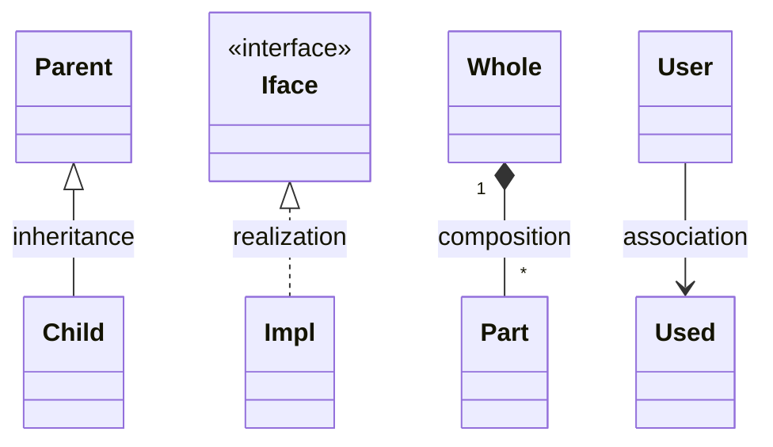

**In plain words:** this legend shows the four lines once, with made-up names, so you can recognize them in the real diagrams below.

**Example:** in "`Whole "1" *-- "*" Part`", one whole has any number of parts, for example, one lesson with 50 check-ins.

### 1.2 Sequence diagrams

Each column is a participant: a person, a class, or an outside service. Time runs from top to bottom. A solid arrow is a call or a message, and a dashed arrow is an answer. A frame marked `alt` shows two possible paths, and a frame marked `loop` repeats. A yellow note explains a step.

## 2. Class diagrams

There is one diagram per feature. The three interfaces are shown in section 2.7, in two diagrams, because together they have nine classes, and each diagram has at most eight.

### 2.1 Attendance (part 1): course, lesson and check-in

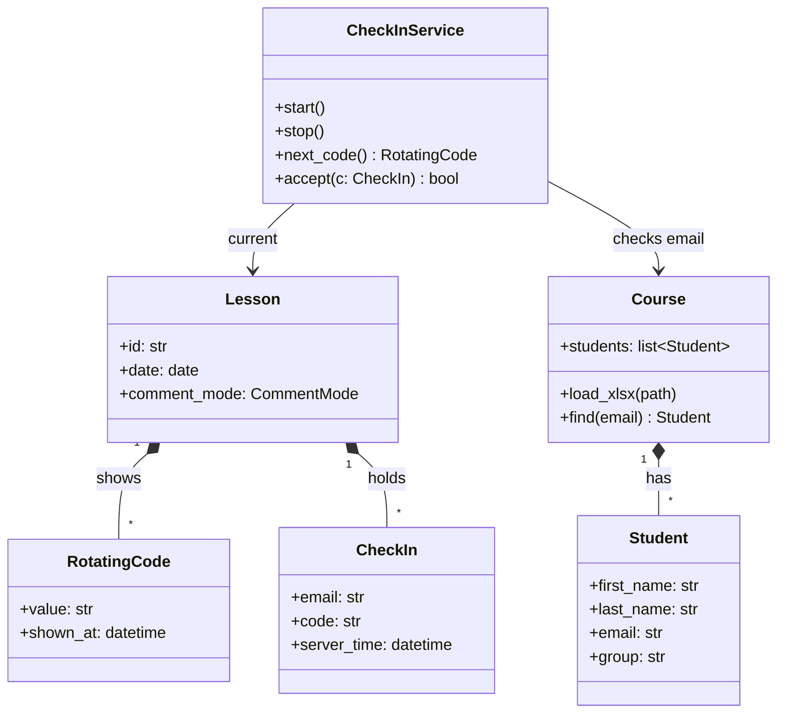

**In plain words:** a `Course` is made of `Student`s, loaded from the `.xlsx` list. A `Lesson` is made of the codes that were shown in it and the check-ins it received. `CheckInService` makes a new code every 10 seconds. For each check-in, it asks two questions:
- Was the code shown in the last 20 seconds?
- Is the email on the course list?

**Example with numbers:** a lesson of 90 minutes, with check-in open for the first 10 minutes. 10 minutes is 600 seconds, so `next_code()` makes 60 `RotatingCode`s. A check-in arrives at 09:05:30 with a code shown at 09:05:20: 10 seconds old, so `accept()` returns `True`. A second check-in uses a code from 09:04:50: 40 seconds old, so `accept()` returns `False`. A third has the email `x@typo.com`: `Course.find()` returns nothing, so it becomes a mismatch.

### 2.2 Attendance (part 2): head count, mismatch and challenge

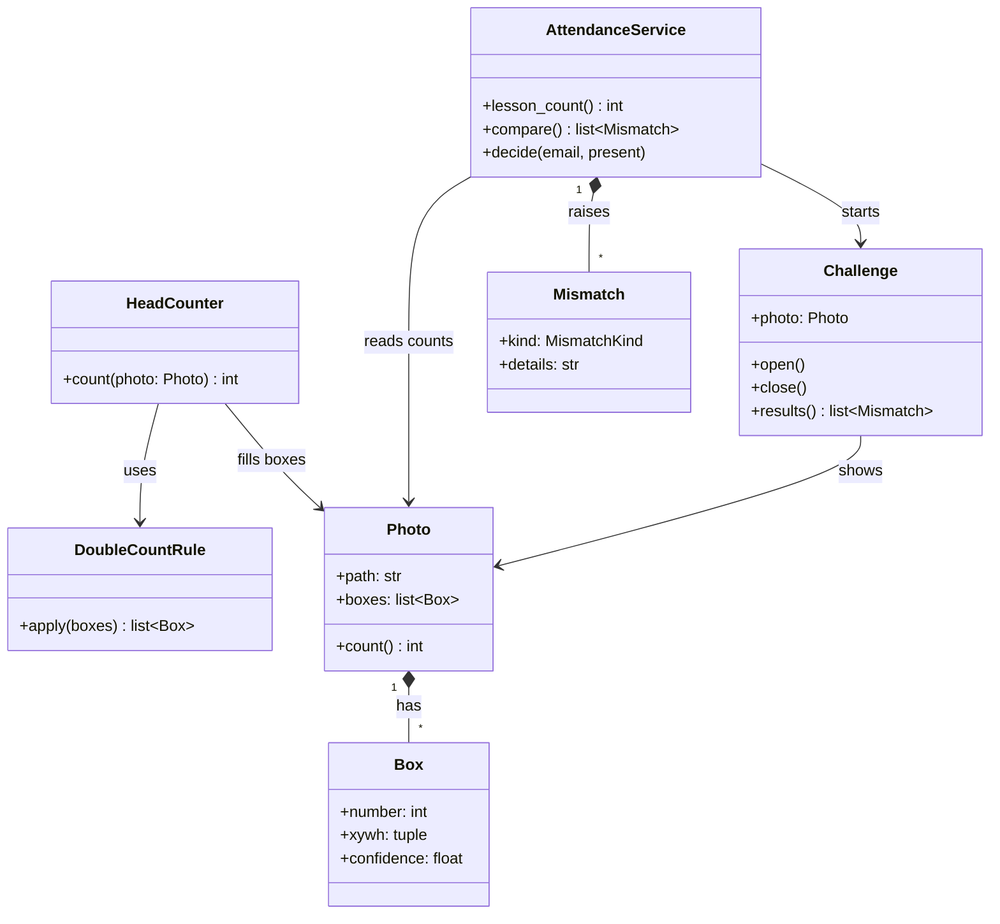

**In plain words:** `HeadCounter` runs the local model on a `Photo`, and fills it with `Box`es. Before that, `DoubleCountRule` merges two boxes of the same person. `AttendanceService` takes the highest count of the lesson's photos, compares it with the accepted check-ins, and raises `Mismatch`es. A `Challenge` shows one photo on the projector, collects the students' answers, and turns problems into more `Mismatch`es. `MismatchKind` has four values: a count gap, an unknown email, a box chosen twice, and "not in the photo".

**Example with numbers:** 3 photos. The model finds 31, 30 and 29 boxes. The rule merges 1 pair in the first photo, which gives 30, 30 and 29. `lesson_count()` returns the highest, 30. With 50 accepted check-ins, `compare()` returns one `Mismatch` of the kind "count gap", with "50 checked in, 30 counted". After the challenge, `results()` returns 3 more of the kind "box chosen twice".

### 2.3 Comments

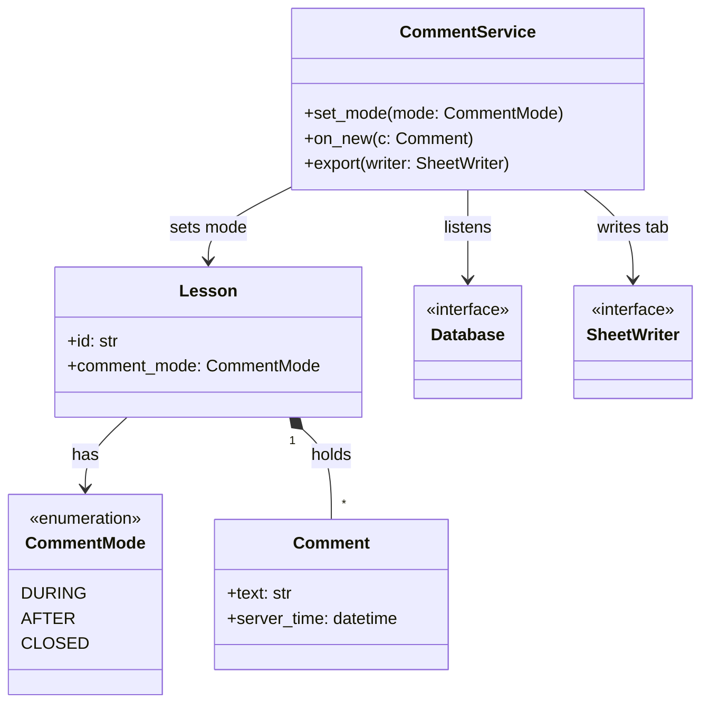

**In plain words:** each `Lesson` has one `CommentMode`:
- `DURING`: open during the lesson.
- `AFTER`: open only after it.
- `CLOSED`.

`CommentService` changes the mode, listens to new comments through `Database`, and at the end writes them to the sheet through `SheetWriter`. A `Comment` has no email field, so it is anonymous by design.

**Example with numbers:** the mode is `AFTER`. During the lesson, the security rules reject 2 comments that students tried to send. After the lesson, 7 comments arrive, and `on_new()` runs 7 times. `export()` writes 7 rows to the "Comments" tab. Then the lecturer sets `CLOSED`.

### 2.4 Polls

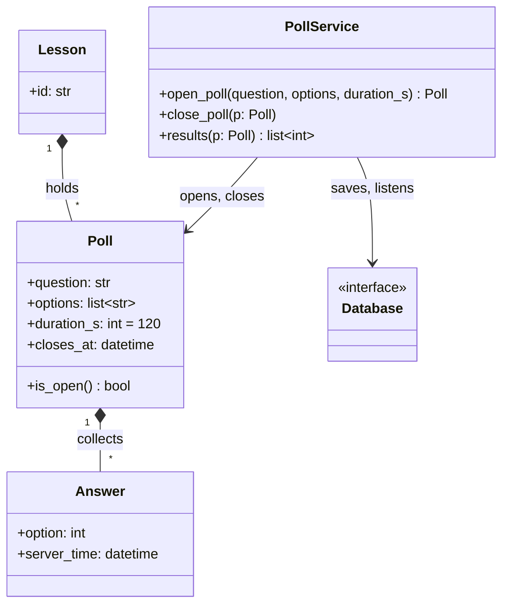

**In plain words:** a `Lesson` holds its `Poll`s, and each `Poll` collects `Answer`s. `PollService` opens a poll with a question, a few options and a duration, closes it, and counts the answers per option. Like a comment, an `Answer` has no email.

**Example with numbers:** `open_poll("Is it clear?", ["Yes", "Partly", "No"], 120)` opens a poll at 10:00:00. So `closes_at` is 10:02:00. 41 answers arrive. At 10:02:00, `close_poll()` runs, and `is_open()` becomes `False`. `results()` returns `[25, 10, 6]`, the number of answers for each option, in order.

### 2.5 Lecture summary

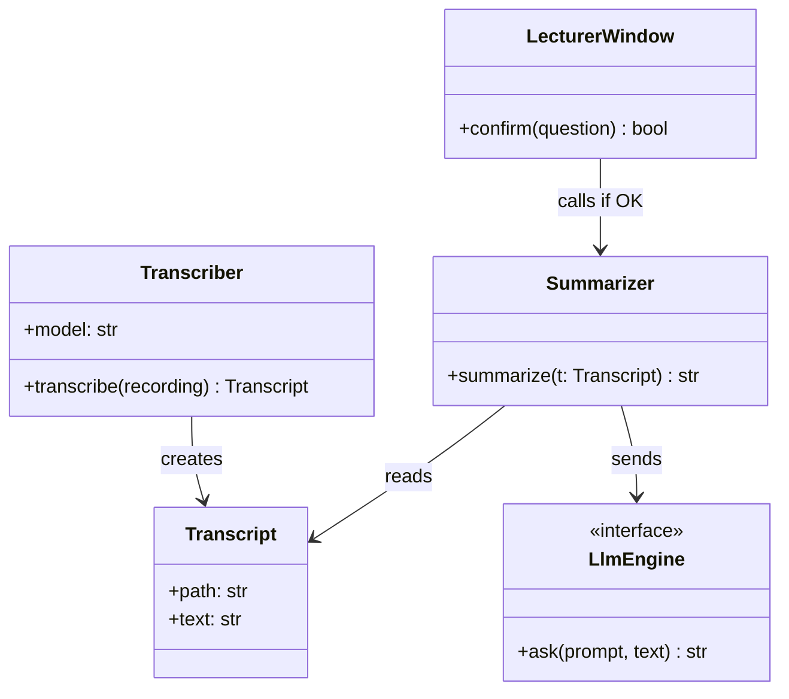

**In plain words:** `Transcriber` turns a recording into a `Transcript`, on the lecturer's computer. The window (`LecturerWindow`) asks the lecturer whether to send it. Only if the lecturer confirms does the window call `Summarizer`, which calls `LlmEngine.ask()`.

Look at the direction of the arrows: the window knows `Summarizer`, but `Summarizer` does not know the window. So the logic does not depend on the screen, and a unit test can call `Summarizer` directly, with no window at all. `Summarizer` also does not know whether the engine is Gemini or the manual backup: that is the point of the interface.

**Example with numbers:** a recording of 90 minutes. At 66.5 seconds of work per minute of recording, `transcribe()` takes about 100 minutes. Then `confirm()` returns `True`, the window calls `summarize()`, and `ask()` uses 1 request from the summary project's 20 per day, leaving 19. If `confirm()` had returned `False`, the window would not call `Summarizer` at all, and the count would stay at 20.

### 2.6 Homework review

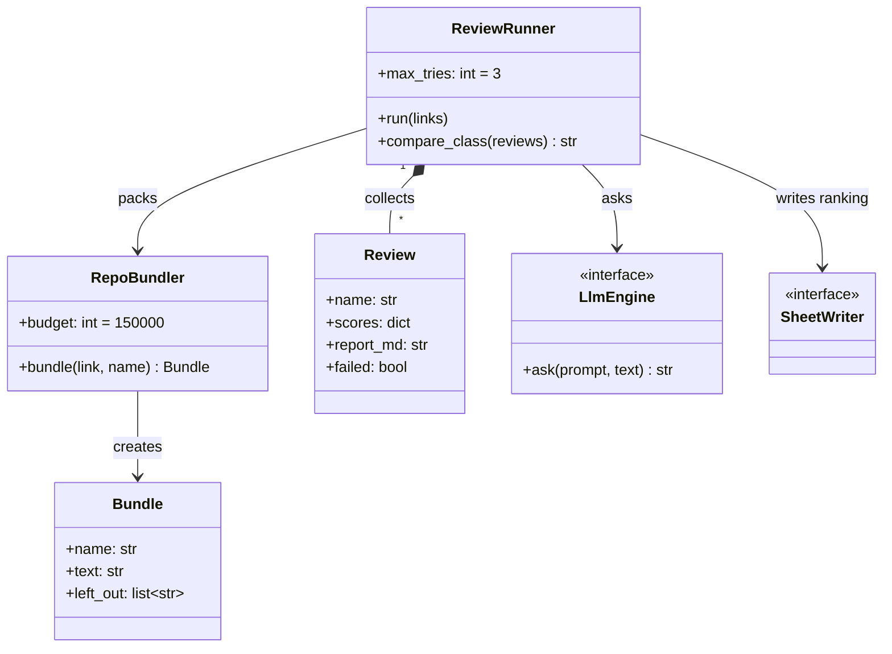

**In plain words:** `ReviewRunner` goes over the links. For each link:
1. `RepoBundler` packs the repository into a `Bundle` with an anonymous name.
2. `ReviewRunner` sends the bundle to `LlmEngine`, and keeps the answer as a `Review`, with a score for each criterion.

Then it writes the ranking through `SheetWriter`, and asks for the class comparison. If a request fails 3 times, the `Review` is marked `failed`, and the runner goes on.

**Example with numbers:** 45 links. Day 1: 20 requests, so reviews 1–20. One of them, Repo G, fails 3 times in a row and is marked `failed = True`. Days 2 and 3 cover the rest. Then `compare_class()` sends one request with a short summary of each of the 44 good reviews.

### 2.7 The three interfaces

Each interface has two implementations. The other classes see only the interface, so an implementation can be replaced without changing them.

**Storage: `Database` and `SheetWriter`**

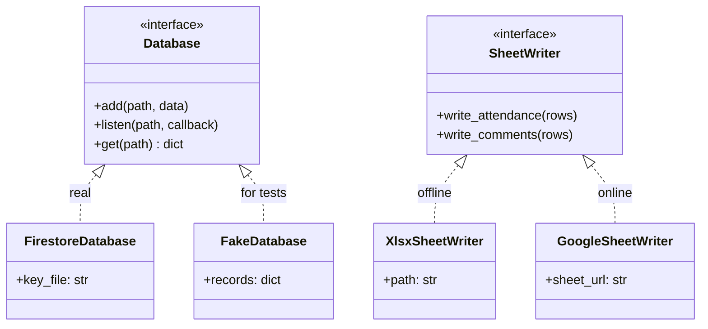

**In plain words:** `Database` is the only way to reach the data. In the sequence diagrams, the object behind this interface appears as `DatabaseGateway` (component C8), so that it is not confused with Firestore itself: Firestore is the database in the cloud, and the gateway is the Python door to it. The real implementation uses Firestore with the service account key. The fake one keeps everything in a Python dictionary in memory, so the unit tests need no network and no key. `SheetWriter` writes the same rows either to a local `.xlsx` file or to a Google Sheet.

**Example with numbers:** a unit test of `CheckInService` gives it a `FakeDatabase` with 3 check-ins: one fresh, one 40 seconds old, and one with an unknown email. The test expects 1 accepted, 1 rejected and 1 mismatch, and runs in well under a second, with no internet. In class, the same `CheckInService` gets a `FirestoreDatabase` instead, and its code does not change.

**LLM: `LlmEngine`**

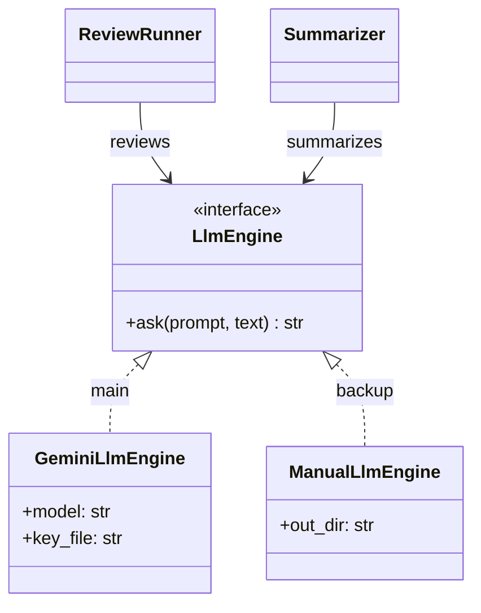

**In plain words:** `LlmEngine` has one method: send a prompt and a text, and get an answer. `GeminiLlmEngine` sends them to the Gemini API, with the model name and the key file as parameters. `ManualLlmEngine` writes the request to a file, and waits for the lecturer to paste back the answer from an LLM chat. Both the review and the summary use the interface, each with its own key file, because each has its own Google project.

**Example with numbers:** the review runs with `GeminiLlmEngine(model="gemini-4-hydrogen", key_file="secrets/...")`. On a day when the API is not available, the lecturer starts it with `ManualLlmEngine` instead. `ReviewRunner` and `Summarizer` stay exactly the same: 0 lines of their code change.

## 3. Sequence diagrams

### 3.1 Check-in

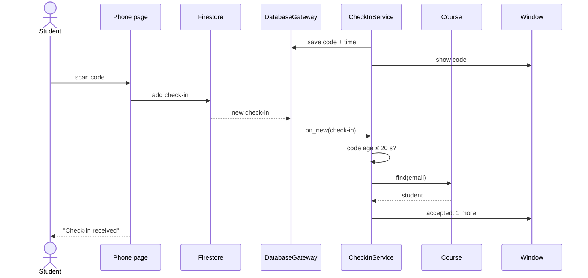

**In plain words:**
1. `CheckInService` saves each new code with the server time, and the window shows it.
2. The student scans the code. The page adds a check-in to Firestore, and the database adds the server time.
3. Firestore pushes it to Python, through the gateway.
4. `CheckInService` checks the age of the code and the email.
5. The window shows one more accepted check-in.

The page tells the student "Check-in received" as soon as Firestore saved it. That message means "saved", not "accepted".

**Example with numbers:** the code "K7Q2" is shown at 09:05:20. The student scans it, and the check-in gets the server time 09:05:27. The age is 7 seconds, which is at most 20, so the check-in passes. The email is on the list. The window counter goes from 41 to 42.

### 3.2 Attendance: head count, mismatch, challenge and decision

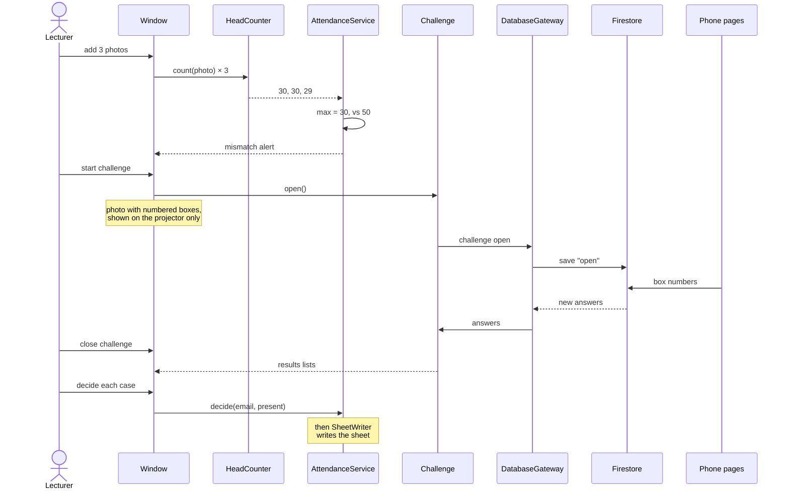

**In plain words:** the lecturer adds the photos. `HeadCounter` counts each one, and `AttendanceService` takes the highest count and compares it with the check-ins. Because they differ, the window shows an alert. The lecturer starts a challenge:
- **The photo:** the window shows it on the projector only, with a number on each box. No arrow carries the photo anywhere: it never leaves the lecturer's computer.
- **The phones:** `Challenge` marks the challenge as open in Firestore, so the phones show a box-number field.
- **The answers:** the students type box numbers on their phones. The phones never talk to the lecturer's computer directly, so the answers go phone → Firestore → `DatabaseGateway` → `Challenge`.

After closing, the window shows the lists. The lecturer decides each case, and then `SheetWriter` writes the sheet. It is not drawn here, to keep the diagram at eight participants.

**Example with numbers:**

| Step | Value |
|---|---|
| Accepted check-ins | 50 |
| Highest count | 30 |
| Gap | 20 |
| Challenge: own box | 27 |
| Challenge: box already taken | 3 boxes chosen twice |
| Challenge: no answer | 20 |
| Lecturer's decision | 20 absent, the 3 shared boxes checked by eye |
| Sheet | 104 rows, one per student on the course list, with this lesson's status |

### 3.3 Comment

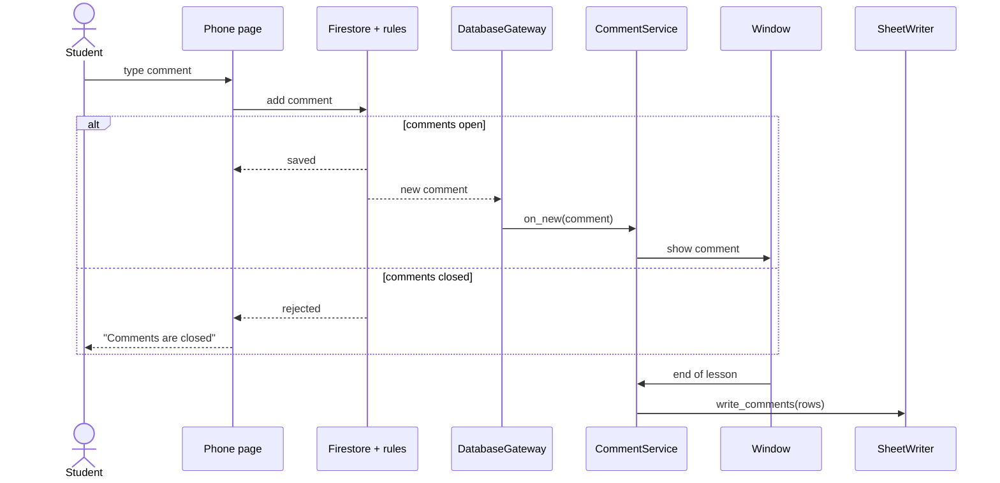

**In plain words:** the student writes a comment, and the page sends it to Firestore. The security rules check it at the entrance:
- **Comments open:** the comment is saved and reaches the lecturer's window.
- **Comments closed:** the comment is rejected, and the student sees why.

At the end of the lesson, `CommentService` writes all the comments to the sheet.

**Example with numbers:** the mode is `DURING`. At 10:15, a student sends "Slower please", and it appears in the window about 3–4 seconds later. If the phone had no network, the comment would wait on the phone and arrive when the network returns. At the end, `write_comments()` writes 12 rows.

### 3.4 Poll

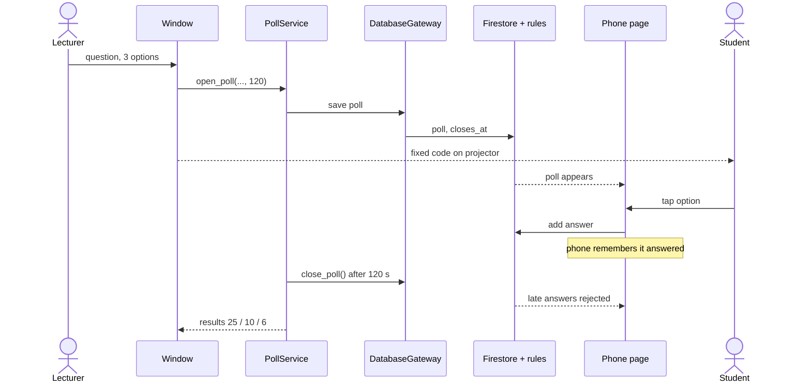

**In plain words:** the lecturer types a question and options. `PollService` saves the poll with its closing time. The window shows a fixed code on the projector, for students whose page is not open. Phones that have the page open get the poll at once. Each phone answers once: it remembers that it answered. After the time ends, the poll is closed, the rules reject late answers, and the window shows the results.

**Example with numbers:** a poll opens at 10:00:00, with `duration_s = 120`. 38 phones already have the page open. 3 more students scan the fixed code. That makes 41 answers by 10:02:00. One student taps twice, and the phone blocks the second tap. An answer sent at 10:02:05 is rejected. Results: 25, 10, 6.

### 3.5 Lecture summary

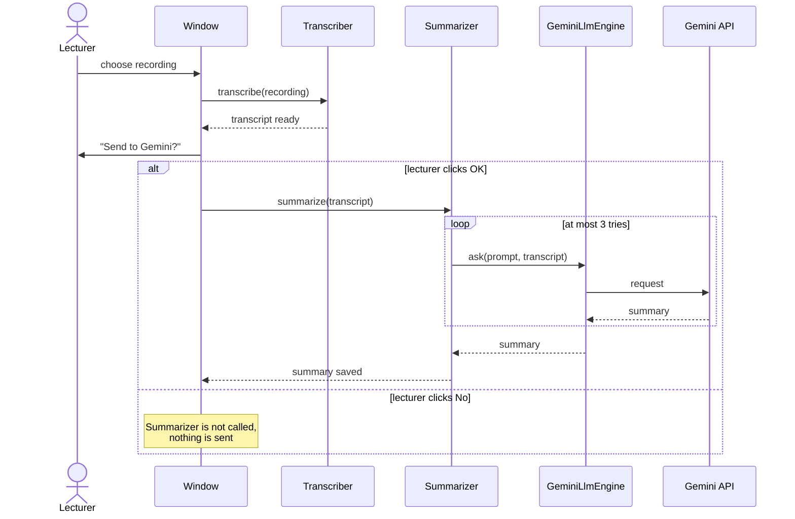

**In plain words:** the transcriber makes a transcript on the computer. Then the window asks the lecturer whether to send it:
- **OK:** the window calls `Summarizer`, the transcript goes to Gemini with up to 3 tries if the model is busy, and the summary is saved.
- **No:** the window does not call `Summarizer` at all, and nothing leaves the computer.

The question is asked by the window, not by `Summarizer`. So `Summarizer` is pure logic, with no screen, and can be tested on its own.

**Example with numbers:** a 90-minute recording takes about 100 minutes to transcribe. The lecturer clicks OK. The first try gets an error 503, and the second try succeeds, so 2 of the 3 tries were used. If all 3 had failed, the window would say that the summary failed, and the transcript would stay.

### 3.6 Homework review

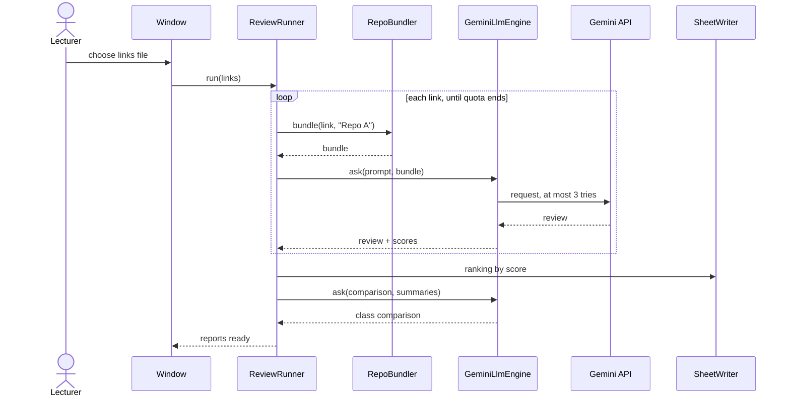

**In plain words:** the runner goes over the links. For each one, it packs the repository under an anonymous name, sends it to Gemini with up to 3 tries, and keeps the review. When the daily quota ends, it stops, and continues the next day with the same model. After all the links, it writes the ranking sheet, and sends one more request for the class comparison.

**Example with numbers:**
- **Day 1:** 20 links are reviewed, about 22 seconds each, so about 7 minutes.
- **Days 2 and 3:** the other 25 links.
- **The end:** one ranking sheet with 45 rows. 1 is marked failed, and 44 have scores. Then 1 more request for the comparison.
