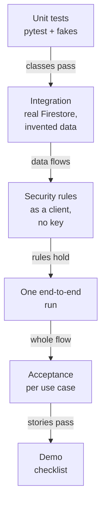
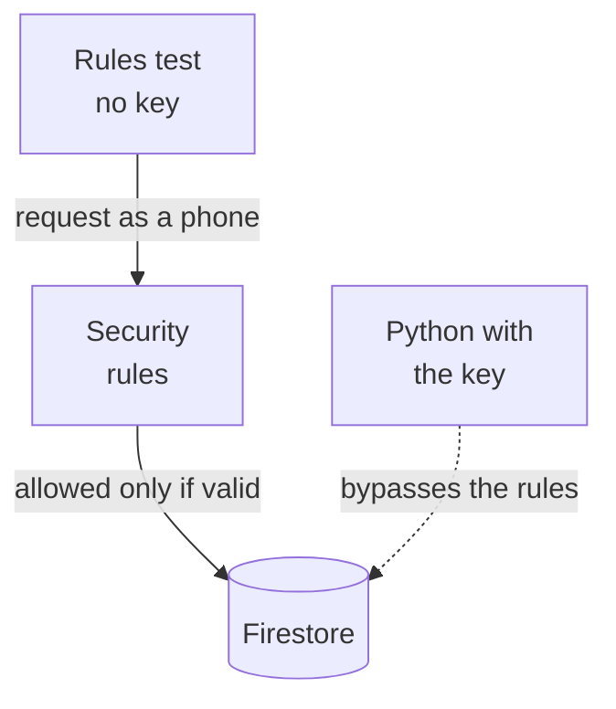

# Testing Strategy

Ex2 in Introduction to Software Engineering (OOP, OOD), Ariel University.
Project: Web-based Teaching Tool.

This document says how we check that the system does what the SRS ([srs.md](srs.md)) asks. It addresses the classes in the design ([design.md](design.md)) one by one, and ends with the checklist for the live demo.

## 1. How to read the diagrams

The two diagrams here are flowcharts, like the ones in [components.md](components.md).

| Sign | Meaning |
|---|---|
| A rectangle | A kind of test, or a part of the system. |
| A solid arrow with a label | What passes, or what comes next. |
| A dashed arrow with a label | A path that skips a check. |

## 2. Test levels

**In plain words:** we test from small to big.
1. **Unit tests:** each class alone, with fake outside services. They are fast, and need no network.
2. **Integration tests:** the real Firestore, with invented data only.
3. **Security rules:** tested the way a phone would send data.
4. **One end-to-end run:** the whole flow, once.
5. **Acceptance tests:** each use case, with its happy path and its edge cases.
6. **The demo checklist:** what we check before and during the lesson.

A level starts only after the level before it passes.

**Example with numbers:** section 3 lists 12 classes. Each has 2 to 5 cases, so about 40 unit tests. They should run in seconds, with no internet, because nothing waits for a network. That is an expectation, not yet measured. The rules table in section 5 has 8 cases, and each case is one small request. In the end-to-end run, the head count alone takes about 18 seconds per phone photo at 1920 (tools report, section 3).

## 3. Unit tests

- **Tool:** pytest. It will be installed in step 10, with approval.
- **How the classes are isolated:** each class gets fakes instead of outside services. The fakes are possible because of the interfaces in design.md, section 2.7:
  - `FakeDatabase`: a dictionary in memory, instead of Firestore.
  - `FakeLlmEngine`: returns a scripted answer, or a scripted error such as 503, instead of Gemini.
  - **A fake clock and a fake wait:** a test can say "now is 09:05:27", and can check the waits of 30 s and 60 s without really waiting.
- **Location:** `tests/unit/`, one file per class.

| Class | Test cases (input → expected) | Requirements |
|---|---|---|
| `Course` | A list with 104 rows → 104 students. A row with no email → a warning, and the row is kept. The same email twice → one student and a warning. | FR-1.1 |
| `CheckInService` | Code saved 7 s before the check-in → accepted. 30 s → accepted (the slowest first check-in in the phone test). 60 s → accepted. 61 s → rejected. An email not on the list → a mismatch. The same email twice → counted once. | FR-2.6 – 2.8 |
| `DoubleCountRule` | Two boxes with the same left edge and top edges within 20% → merged into one. A wide, low box (width ≥ 1.5 × height) under a person → dropped as legs. Two separate people side by side, like the cases in photos p13 and p23 → not merged. | FR-3.3 |
| `AttendanceService` | Photo counts 30, 30, 29 → lesson count 30, not 89. 50 check-ins vs 30 → one "count gap". 30 vs 30 → no mismatch. 1 unknown email → one "unknown email". `decide()` → the status is saved. | FR-3.4, FR-4.1, FR-6.1 |
| `Challenge` | Box 12 chosen by 2 students → "box chosen twice". "Not in the photo" → a mismatch. 20 checked-in students with no answer → listed. Box 7 chosen by no one → listed. An answer after `close()` → rejected. | FR-5.3 – 5.5 |
| `CommentService` | 7 comments → 7 rows in the "Comments" tab, with no email. Mode `AFTER` → the mode is saved on the lesson. | FR-7.3, FR-7.6 |
| `PollService` | Opened at 10:00:00 with 120 s → `closes_at` is 10:02:00. Answers 0, 0, 1, 2, 0 → results [3, 1, 1]. `close_poll()` at 10:01:00 → closed early. | FR-8.1, 8.6, 8.7 |
| `Summarizer` | A fake engine answers → the summary is saved. Hydrogen fails 3 times → the next call goes to `gemini-3.6-flash`, and the file records that model. Waits are 30 s, then 60 s. The test needs no window. | FR-9.5, FR-9.7 |
| `LecturerWindow` (logic only) | `confirm()` returns `False` → `Summarizer` is not called. A fake `Summarizer` counts 0 calls. | FR-9.4, FR-9.6 |
| `ReviewRunner` | The engine fails 3 times on Repo G → `failed = True`, and the runner goes on to Repo H. Waits are 30 s, then 60 s. The quota is used up after 20 requests → the run stops, and the other links stay for the next day. The model never changes. | FR-10.5, FR-10.7 |
| `RepoBundler` | A repository over 150,000 characters → the bundle stops at the budget, and lists the files left out. 3 links → names Repo A, B, C. | FR-10.2, FR-10.3 |
| `XlsxSheetWriter` | Write 3 students × 2 lessons → read the file back with openpyxl, and get the same 6 statuses. | FR-6.2, FR-6.3 |

## 4. Integration tests (real Firestore, invented data)

These tests use `FirestoreDatabase` with the service account key, on test collections with invented data only.
- **Write and read back:** a lesson, a check-in, a comment, a poll and an answer are written and read back.
- **Real-time listening:** Python receives a record written from a browser. This was already measured in the tools report, section 1: about 3–4 seconds from the phone.
- **Google Sheets:** 10 invented rows are written and read back. This was already done in the tools report, section 4.

**Important:** these tests run with the key, and the Admin SDK bypasses the security rules. So they check that the data flows, **not** that the rules protect it. That is section 5.

## 5. Security rules: tested as a client, without the key

**In plain words:** Python with the service account key uses the Admin SDK, which skips the security rules (dashed arrow). So a rules test from Python with the key always passes, and checks nothing. The rules are tested the way a phone reaches them, with no key:
- from the page in a browser, or
- with a request with no credentials to Firestore's web address.

| Case | Request | Expected |
|---|---|---|
| A valid comment, while comments are open | create, 1–200 characters | allowed |
| A comment while comments are closed | create | **denied** (FR-7.3) |
| A comment of 201 characters | create | **denied** |
| An extra field, for example `email` on a comment | create | **denied** (FR-7.2) |
| An answer after the poll's `closes_at` | create | **denied** (FR-8.6) |
| A challenge answer after the challenge is closed | create | **denied** (FR-5.4) |
| Changing or deleting any record | update, delete | **denied** (NFR-12) |
| Reading check-ins from a phone | read | **denied** (NFR-12): the emails are read only by Python |
| A check-in with a code saved more than 60 s ago | create | **denied** (FR-2.6) |
| A check-in with a code that does not exist | create | **denied** (FR-2.6) |
| Any other collection | read, create | **denied** |

**Example with numbers:** 11 cases. Each one runs once with no key, and then once with the key. Expected: with no key, 1 is allowed and 10 are denied. With the key, all 11 pass, which shows why the key must not be used for this test.

## 6. One end-to-end run

Once, before the demo, with invented data and three phones:
1. Load an invented course list of 10 students, and open a lesson.
2. **Check-in:**
   - Two phones check in with fresh codes.
   - One phone uses a code from a photo, taken more than 60 seconds earlier. It must be rejected, and the phone must say that the code expired.
3. **Head count:** add a new photo, count it, and check the mismatch alert.
4. **Challenge:** run a challenge, with one box chosen twice.
5. **Decision and sheet:** decide each case, and write the `.xlsx` file.
6. **Comment and poll:** send a comment, and run a poll of 2 minutes.
7. **Check:** the sheet has 10 rows with the right statuses, and a "Comments" tab.

The Gemini features are not part of this live run (D46). The summary and the review are run before the lesson, on their own, and their saved results are checked: one summary file that names its model, and one report per link.

## 7. Acceptance tests (per use case)

Each use case passes when its happy path and every edge case behave as the use case says. Most edge cases are covered by the unit tests above. The table shows where each one is checked.

| Use case | Happy path checked in | Edge cases checked in |
|---|---|---|
| UC-1 Course list and lesson | End-to-end run | Unit: `Course` (no email, duplicate email) |
| UC-2 Check-in | End-to-end run | Unit: `CheckInService` (old code, unknown email, twice). Integration: no network on the phone |
| UC-3 Photos and count | End-to-end run, new photo | Unit: `DoubleCountRule`, `AttendanceService` (highest count, same photo twice) |
| UC-4 Mismatch | End-to-end run | Unit: `AttendanceService` (equal, more, fewer, unknown email) |
| UC-5 Challenge | End-to-end run | Unit: `Challenge`. Rules: answer after closing |
| UC-6 Decision and sheet | End-to-end run | Unit: `XlsxSheetWriter`. Integration: Google Sheets with invented data |
| UC-7 Write a comment | End-to-end run | Rules: closed, too long, extra field |
| UC-8 Read comments | End-to-end run | Unit: `CommentService` |
| UC-9 – UC-11 Polls | End-to-end run | Unit: `PollService`. Rules: late answer. Page: second tap blocked |
| UC-12 Summary | Run before class | Unit: `Summarizer`, `LecturerWindow` (no OK, 3 failures, fallback model) |
| UC-13 Review | Run before class | Unit: `ReviewRunner`, `RepoBundler` (3 failures, quota, budget) |

## 8. Demo checklist

**Before the lesson:**
- [ ] The summary of a recent lesson is ready. Its file names the model that made it.
- [ ] The review of the chosen links is ready: one report per link, the ranking sheet, and the class comparison.
- [ ] The recorded backup run is linked from the README.
- [ ] Both keys are in `secrets/`, and `git status` shows no secrets.
- [ ] The real course list is loaded from the local `.xlsx` file. The demo must be real, in this class, so each student checks in with their own course email (D49).
- [ ] The deployed security rules block phones from reading check-ins.
- [ ] The laptop is connected to the projector, and the page opens on a phone.

**Live in class:**
- [ ] Students check in from their phones with the code on the projector.
- [ ] A **new** photo of the class is taken with the phone, and moved to the laptop, preferably by cable or a local transfer. **Do not send it through WhatsApp as a regular photo**: WhatsApp makes it smaller, which can hurt the count. **The photo must be JPEG, not HEIC** (the iPhone's default format): the model cannot read HEIC, and the window says so. An email from the iPhone arrives as JPEG at full size (4032 × 3024 in a test on 25/11).
- [ ] The new photo is counted. The count is within ±10% of a quick manual count (NFR-3).
- [ ] A mismatch alert appears, and a challenge runs on the projector only.
- [ ] The lecturer decides, and the sheet is written as a local `.xlsx` file only, not to Google Sheets. It opens in Excel by itself, so the class sees it at once.

**After the lesson:**
- [ ] The lesson is closed, and its data is deleted from Firestore (FR-1.5). A read with the key confirms that no check-in is left.
- [ ] A comment and a 2-minute poll.
- [ ] The saved summary and review results are shown.

## 9. Requirements and their tests

| Requirements | Tests |
|---|---|
| FR-1 Lessons and course list | Unit `Course`; end-to-end |
| FR-2 Check-in | Unit `CheckInService`; integration; end-to-end |
| FR-3 Head count | Unit `DoubleCountRule`, `AttendanceService`; demo on a new photo |
| FR-4 Mismatch | Unit `AttendanceService`; end-to-end |
| FR-5 Challenge | Unit `Challenge`; rules; end-to-end |
| FR-6 Decision and sheet | Unit `XlsxSheetWriter`; integration (Google Sheets); end-to-end |
| FR-7 Comments | Unit `CommentService`; rules; integration (no network) |
| FR-8 Polls | Unit `PollService`; rules; page (second tap) |
| FR-9 Summary | Unit `Summarizer`, `LecturerWindow`; run before class |
| FR-10 Homework review | Unit `ReviewRunner`, `RepoBundler`; run before class |
| NFR-3, NFR-4 Head count accuracy and speed | Demo on a new photo; tools report section 3 |
| NFR-5, NFR-8 Comment speed, no network | Integration; tools report section 1 |
| NFR-9 – NFR-11 Privacy | Review of what leaves the computer; rules (no email field) |
| NFR-12 Security rules | Rules, as a client (section 5) |
| NFR-13 Secrets | `git status` before every commit |

## 10. What is not tested, and why

- **Android phones:** only an iPhone with Chrome was tested.
- **The head count on new photos:** the setting (1920, strict rule) was chosen on 5 class photos, one of them a new iPhone photo. It works for phone photos taken from the front. On low-resolution ceiling security-camera frames (SCUT-HEAD PartA, 15 images), no option met ±10%: the 6 crowded frames, with 56–77 heads, were missed by 29.9–41.6% (tools report, section 3). The real test is the new photo in the demo. The saved boxes (`course-materials/headcount-output/exp-boxes.json`) let new rules be checked in seconds.
- **The Gemini summary:** on 25/11, 6 of 6 tries failed with error 503 (tools report, section 6). The fallback model `gemini-3.6-flash` has not been tried yet. Its free-tier limits are 5 requests per minute and 20 per day (tools report, section 7).
- **The QR code on a real projector:** it was tested only on a laptop screen, from up to 5 meters.
- **Load:** a class of about 100 phones at once was not tested. Each request is small, and the free plan's daily limits are far above one lesson.
